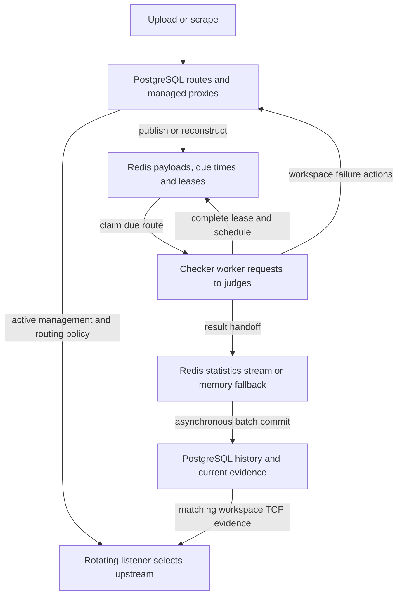

# Following a proxy through the backend

This walkthrough follows an authenticated route such as
`gateway.example.test:8080` with one exact username/password pair. Importing the
same host and port with different credentials creates a different route.
Several workspaces can manage the same route, each with its own lifecycle,
checker settings, tags, failure streak and health assessment.

The [domain glossary](../CONTEXT.md) defines these terms. User accounts gain
access through workspace memberships. Checker and proxy database symbols use
workspace terminology; deprecated wrappers and aliases retain historical names.
Persisted table names such as `user_proxies` and the
`PROXY_STATISTICS_TENANT_OVERLOAD_POLICIES` environment name remain compatible
with existing deployments. Their ownership and policy IDs identify workspaces.

## Suggested reading order

1. Read the [glossary](../CONTEXT.md), then the decisions about
   [workspace ownership](adr/0005-make-workspaces-the-ownership-and-capacity-boundary.md),
   [Redis credentials](adr/0002-keep-hot-proxy-credentials-plaintext-in-redis.md)
   and [workspace health evidence](adr/0011-scope-managed-proxy-health-to-effective-checker-settings.md).
2. Read [app.Run](../internal/app/app.go) and
   [bootstrap.Setup](../internal/app/bootstrap/setup.go) to find where settings,
   database setup, queue reconstruction, workers and listeners start.
3. Follow `addProxies` and `ingestProxyUploadMultipartWithTags` in the
   [upload handler](../internal/app/server/route_proxy_handler.go) into
   `InsertAndGetProxiesWithWorkspace` in the
   [proxy ingestion](../internal/database/database_proxy_ingestion.go).
4. Read `AddToQueue`, `GetNextProxyContext` and `RequeueProxy` in the
   [proxy queue](../internal/jobs/queue/proxy/proxy_queue.go), alongside
   [pop.lua](../internal/jobs/queue/proxy/pop.lua) and
   [complete.lua](../internal/jobs/queue/proxy/complete.lua).
5. Follow `work`, `buildRequestAssignments`, `processJudgeAssignments` and
   `CheckProxyWithRetries` in the
   [checker worker](../internal/jobs/checker/thread_handler.go). Then read the
   [ownership verifier](../internal/jobs/checker/ownership_verifier.go) and
   [failure tracker](../internal/jobs/checker/failure_tracker.go).
   `GetNextJudge`, `AddWorkspaceJudge` and `SetWorkspaceJudges` in the
   [workspace judge cache](../internal/jobs/checker/judges/judges_handler.go)
   select judges and apply cache updates. Their
   [Redis synchronization](../internal/jobs/checker/judges/redis_sync.go) retains
   historical event strings and JSON keys for compatibility between instances.
6. Follow the result into [statistics ingestion](../internal/jobs/runtime/proxy_statistics.go),
   [InsertProxyStatistics](../internal/database/database_proxy_statistics_handl.go)
   and [latest evidence updates](../internal/database/database_proxy_status_handler.go).
7. Read `GetNextRotatingProxy` and `buildAliveProxyQuery` in the
   [rotation database handler](../internal/database/database_rotating_proxy_handler.go),
   then follow the selected route into the
   [listener handlers](../internal/rotatingproxy/handler.go).

## Proxy database file map

The proxy database operations share the `database` package. Find each
responsibility in these files:

| Responsibility | File |
| --- | --- |
| Route import, deduplication and workspace management | [database_proxy_ingestion.go](../internal/database/database_proxy_ingestion.go) |
| Active route batches for queue reconstruction | [database_proxy_inventory.go](../internal/database/database_proxy_inventory.go) |
| Proxy pages, sorting and response mapping | [database_proxy_list.go](../internal/database/database_proxy_list.go) |
| List filters and available filter values | [database_proxy_filters.go](../internal/database/database_proxy_filters.go) |
| Text, tag and IP search | [database_proxy_search.go](../internal/database/database_proxy_search.go) |
| Recent checks, fastest routes and their caches | [database_proxy_dashboard.go](../internal/database/database_proxy_dashboard.go) |
| Route details, queue state and check history | [database_proxy_detail.go](../internal/database/database_proxy_detail.go) |
| Managed proxy deletion, pausing and activation | [database_proxy_lifecycle.go](../internal/database/database_proxy_lifecycle.go) |
| Failure/capacity cleanup and orphan route deletion | [database_proxy_cleanup.go](../internal/database/database_proxy_cleanup.go) |
| Export snapshots, batches and export filters | [database_proxy_export.go](../internal/database/database_proxy_export.go) |
| Reputation response mapping and shared reputation filters | [database_proxy_reputation_helpers.go](../internal/database/database_proxy_reputation_helpers.go) |
| Historical exported names | [database_proxy_compat.go](../internal/database/database_proxy_compat.go) |

## State and execution boundaries



| State | Authority and lifetime |
| --- | --- |
| PostgreSQL routes, managed proxies, workspace settings, tags and rotator configuration | Durable resource state. Managed proxies contain encrypted credential copies and lifecycle state. |
| PostgreSQL check history, stream event ledger, usage/check counters and latest evidence | A statistics transaction commits these together. Latest evidence is derived from history and scoped to workspace and configuration. |
| PostgreSQL reputation and filter/source read models | Derived state refreshed after result persistence. It can lag committed history and latest evidence. |
| Redis proxy payloads, sorted sets and queue heads | Runtime copies of active inventory, with due times and temporary worker leases. Startup and Redis-loss recovery reconstruct them from PostgreSQL. |
| Redis statistics stream and its pending entries | Results awaiting database ingestion. This is a replayable handoff, not a PostgreSQL commit; surviving a Redis restart depends on Redis persistence. |
| In-process checker snapshots, HTTP clients, dashboard caches and memory statistics buffers | Runtime state. Checker snapshots compile persisted settings; memory statistics remain volatile until their database transaction commits. |

PostgreSQL is authoritative for resources and committed results. Reconstructing
the proxy queue restores active inventory, but cannot recreate check results
lost before PostgreSQL ingestion.

## Import and PostgreSQL storage

The upload handler resolves the selected workspace from the request, validates
tags, parses bounded chunks and filters blacklisted routes. Each flush calls
`InsertAndGetProxiesWithWorkspace`.

The database handler canonicalizes hosts and computes a keyed fingerprint of
host, port and the exact credentials. It deduplicates routes by that fingerprint
and uses one transaction to upsert routes and their workspace management.
Existing managed proxies keep their lifecycle state on reimport. New management
beyond workspace capacity is stored as paused. A route may therefore exist in
PostgreSQL without qualifying for the checker queue.

[Proxy](../internal/domain/proxy_model.go) stores the canonical host, port and
fingerprint. Its in-memory `Username` and `Password` fields are not database
columns. [ManagedProxy](../internal/domain/user_proxy_model.go) stores each
workspace's encrypted credential copy in `user_proxies`; its model hooks encrypt
on save and decrypt on load. The legacy `Proxy.IP` field can hold a hostname.
Literal IPs also have an `inet` projection for indexed subnet operations.

After committing, the database handler loads every active workspace managing
each imported route. This complete list allows the checker to share work across
workspaces. The upload handler then assigns tags, starts metadata enrichment
asynchronously and publishes the routes to Redis.

These steps are separate operations. An error loading committed routes or
assigning tags does not undo the import transaction. A later upload error does
not undo earlier batches. Redis publication failures are logged without failing
an otherwise successful upload, so a successful response does not promise an
immediate check. Startup reconstruction republishes active routes; it does not
rely on the original upload still being available.

Scraping joins the same path in `handleScrapedHTML` in the
[scraper worker](../internal/jobs/scraper/thread_handler.go). It imports for the
source's subscribed workspaces, records source associations, applies source tags
and adds the routes to the proxy queue.

Every completed source fetch uses the configured scrape interval after success
or failure, without failure multipliers. Redis stores the next attempt for each
URL and fetch mode separately from the source payload. A pending browser fetch
therefore cannot repeat completed HTTP work. Local browser or subscription-lookup
failures defer pending work without replacing the last scrape result. Valid
`Retry-After` deadlines postpone both modes for the URL and survive explicit
requeues. Requeueing a source with an active claim joins its current attempt.
Workers renew the five-minute lease during long fetches and blocked HTML
handoffs, and cancel work if renewal fails. Claim tokens fence mode progress
against newer workers, while completion merges provider deadlines by maximum
even if the observing worker lost its claim. Removed sources stay removed.
Source details expose the next attempt time and its reason.

These changes are confined to source scheduling. They add no cryptographic
operations, JSON encodes, Redis commands, or database queries per proxy check.

## Redis scheduling and worker leases

`AddToQueue` writes a compact payload at `proxy:<hash>`. Current payloads carry
the route ID, host, port, credentials, stored hash and active workspace IDs.
Routes are distributed across sorted-set shards. Scores are due times in Unix
milliseconds; `proxy_queue_heads` indexes the earliest score in each shard.
Batch imports spread initial due times across the checking interval.

`GetNextProxyContext` waits until a route is due. `pop.lua` atomically reads its
payload and moves its score to a five-minute lease expiry. The exact `0.5`
fraction marks a lease without a separate key. The returned `QueueLease` belongs
to that worker and records the score, shard, original payload and cancellation
context. Other workers can reclaim the route when the lease expires.

Long checks renew the lease between outbound attempts when less than two
minutes remain. Short checks need no renewal command. Completion and worker
removal compare the lease score; removal also checks the original payload so
it cannot erase a concurrent import. A worker that loses its lease abandons the
cycle, and a panic or interrupted cycle leaves the route recoverable after
expiry.

The normal plaintext path reuses the hash in the payload. It performs no queue
credential encryption/decryption, fingerprint calculation or database credential
load. `PROXY_QUEUE_ENCRYPT_CREDENTIALS=false` is the default. Redis is trusted
runtime infrastructure and must use private networking, authentication,
restricted ACLs, TLS for remote connections, and encrypted volumes and backups.
The [Redis credential decision](adr/0002-keep-hot-proxy-credentials-plaintext-in-redis.md)
explains the throughput tradeoff.

Opt-in encryption encrypts new or changed payloads and accepts decryption on
each dequeue. Readers also support legacy plaintext and encrypted payloads,
migrating them lazily. Keep `PROXY_ENCRYPTION_KEY` stable because database
credentials, route fingerprints and legacy encrypted queue entries depend on it.

## Checking and workspace verdicts

The dispatcher adjusts the worker count. Each `work` loop claims one route,
refreshes workspace settings, builds request assignments and sends requests to
judges through the route. A judge is a configured URL that supplies a response
for validation; each workspace supplies its own validation rule.

[checkerconfig](../internal/checkerconfig/cache.go) holds complete compiled
snapshots of workspace defaults, matching tag rules and judge configuration.
Loading and configuration identities are computed at startup, on mutations and
during background reconciliation. They stay outside individual checks.
`refreshProxyWorkspaces` uses these snapshots; the database/cache fallback is
for a checker whose snapshots are not yet ready. The
[tag settings decision](adr/0010-resolve-tag-checker-settings-from-runtime-snapshots.md)
explains this boundary.

`buildRequestAssignments` shares one outbound request when judge, proxy
protocol, transport, timeout and retry budget match. Each workspace still
validates the returned body independently. Two workspaces can receive opposite
verdicts from the same response. `CheckEvidence` carries those verdicts and their
precompiled configuration keys. The statistic's aggregate `Alive` value is true
when any participating workspace accepts the response; it does not define
another workspace's managed-proxy health.

`CheckProxyWithRetries` makes an initial request even when retries is zero. It
retries request errors, then stops on a successful request. Response validation
happens afterward and does not cause retries. Its response time describes the
last request in milliseconds, and its attempt value is zero-based. Each
assignment produces one statistic for the completed retry sequence, rather than
one history row per retry or participating workspace. Ordinary request failures
produce failed statistics; lease loss or worker cancellation aborts the cycle.

## Failure actions and requeueing

After handing off results, the worker waits for batched failure tracking. An
eligible cycle resets a workspace's streak if any of its checks succeeds and
increments it otherwise. Disabled protocols, missing judges and blocked judges
can leave a workspace with no eligible checks; that cycle does not change its
streak. Threshold actions pause or delete only that workspace's managed proxy.
Other workspaces' management of the shared route survives.

Failure tracking can return ownership changes alongside an error if some
database actions already committed. The worker still removes those workspace
IDs from its payload and handles routes with no active management.

`verifyProxyOwnership` then checks whether any workspace still actively manages
the route. Calls share batched database lookups instead of each worker issuing
its own query. This is a point-in-time observation, not a reservation: management
can change during a check. A negative result removes the queue entry. A lookup
error leaves ownership unknown, so the worker attempts to requeue the route.

`RequeueProxy` completes the lease and updates sorted-set scheduling state. It
schedules from the later of the previous scheduled time and the current time,
plus the checking interval. It does not rewrite `proxy:<hash>`, encode JSON or
encrypt credentials. An ownership change uses `RequeueProxyWithPayload` instead.
If an import changed the payload during the check, `complete.lua` merges the
worker's ownership delta into that newer payload, retaining newly added
workspaces and credentials. Both requeue forms reject a stale lease.

## Result admission, persistence and recovery

`AddProxyStatisticForWorkspaces` hands the result to asynchronous ingestion. Its
return value is void: it reports neither admission nor a durable commit. The
checker can finish its cycle and schedule another check before this result is
visible in PostgreSQL.

Redis Streams are enabled by default. Producers append to
`magpie:proxy_statistics:stream`; consumers share a group and buffer batches.
The normal flush threshold is 5,000 results or a 15-second timer per worker.
Partial pending-recovery batches also flush before waiting for new traffic.
Memory consumers remain available when Redis is disabled, initialization has
not finished or stream admission fails. Initialization retries after an outage.

The default overload policy is `block` with a 500 ms producer wait budget.
Stream admission retries sleep for 250 ms; individual Redis operations have
their own timeouts, so that budget is not an exact wall-clock deadline. After
stream retries, the producer tries the 20,000-entry memory queue with any
remaining budget. `drop_new` rejects a result immediately when the stream is at
its configured cap, or when the fallback queue has no room. An intentional
stream rejection bypasses fallback. `evict_oldest` applies approximate stream
trimming during `XADD` and can discard unread or pending results; memory fallback
uses a timed wait instead of eviction. Concurrent stream admissions can exceed
the nominal cap because length checks and appends are separate operations.

The `PROXY_STATISTICS_TENANT_OVERLOAD_POLICIES` setting uses workspace IDs.
Shared results select the strongest policy among the default and applicable
overrides: `block`, then `drop_new`, then `evict_oldest`. Overrides cannot lower
the default's priority. A nonpositive
`PROXY_STATISTICS_PRODUCER_BLOCK_TIMEOUT_MS` creates no memory wait but allows
unlimited stream retries under `block`. Rejected new results are counted and
logged; callers receive no error.

Before inserting, consumers filter routes that have been deleted since checking.
Malformed stream entries are logged and discarded with acknowledgement/deletion.
These are intentional exclusions, so a successful flush does not imply every
submitted result became a history row.

`InsertProxyStatistics` commits replay-event identities, accepted history,
check/usage counters, latest evidence and durable reputation-refresh requests
in one PostgreSQL transaction. Latest pointers use workspace, configuration
key, route and protocol. A delayed older result cannot replace newer evidence;
obsolete configuration evidence remains history without defining current health.
Filter/source read models, reputation calculation and dashboard cache refreshes
run asynchronously after this boundary and can lag it.
During shutdown, producers stop first, then statistics and usage consumers join
their workers, including reputation refreshes. Read models stop last. They join
the periodic source worker before draining pending proxy IDs, then drain all
coalesced source/workspace pairs before shared clients close. This order includes
source invalidations generated by the final proxy refresh and any failed batch
requeued by a canceled source query.

Stream consumers delete and acknowledge IDs only after handling their decoded
results successfully. If a database write fails, they retain the batch and leave
the IDs pending. If the commit succeeds but acknowledgement fails, they retry
acknowledgement; another consumer can also reclaim idle pending entries. The
transactional event ledger prevents replay from duplicating history or counters.
Stream maintenance retains replay protection when retiring ledger identities,
using a durable floor and preserving unread and pending entries.

Redis acceptance provides replay while entries remain in Redis, subject to its
persistence and the chosen overload policy. PostgreSQL transaction commit is
the durable result boundary. The memory path has no stream identity or restart
recovery. On cancellation, memory workers drain available entries and make one
final bounded insert attempt; a failed final attempt loses that buffered data.
Stream workers leave unfinished entries pending for later recovery.

## Rotation uses committed evidence

The [rotating proxy manager](../internal/rotatingproxy/manager.go) starts the
listeners assigned to this backend instance and reconciles them with persisted
configuration. A listener authenticates a client when required, then calls
`GetNextRotatingProxy` for its workspace and rotator.

Selection runs in a transaction that locks the rotator row. It selects the next
qualifying route by ID after the previous selection, wrapping to the first
candidate. Candidates must have active management in that workspace and current
successful evidence for the requested upstream protocol over TCP. Reputation
and uptime filters can narrow the pool. Legacy generation-zero fixtures retain
their compatibility path for unattributed results.

Selection advances the cursor and timestamp and loads that workspace's
credentials before returning. The listener then connects upstream and forwards
HTTP, CONNECT or SOCKS traffic. A connection failure does not undo the selection
transaction. Selection does not run a new check or reserve an upstream route
exclusively. A route with an in-flight or queued successful result becomes
eligible only when matching evidence commits; configuration edits can mask
health while their projection is pending.

## Tests to read before a small change

| Change area | Tests that explain the contract |
| --- | --- |
| Import scope and storage | [route_proxy_handler_test.go](../internal/app/server/route_proxy_handler_test.go) verifies explicit workspace selection. [proxy_access_storage_test.go](../internal/database/proxy_access_storage_test.go) covers exact credentials, IPv6 and provider hostnames. |
| Plaintext queue cost | [proxy_queue_test.go](../internal/jobs/queue/proxy/proxy_queue_test.go): `TestQueuedProxyToDomainProxy_CurrentPlaintextPayloadReusesHashWithoutEncryptionKey` and `TestRequeueProxy_OnlyPersistsPayloadWhenRequested`. [proxy_queue_concurrency_test.go](../internal/jobs/queue/proxy/proxy_queue_concurrency_test.go): `TestPlaintextProxyCycleCommandBudgetAndPayload`. |
| Lease and ownership races | [proxy_queue_concurrency_test.go](../internal/jobs/queue/proxy/proxy_queue_concurrency_test.go) covers concurrent imports and stale completion. [proxy_lease_test.go](../internal/jobs/checker/proxy_lease_test.go) covers renewal across retries. [ownership_verifier_test.go](../internal/jobs/checker/ownership_verifier_test.go) observes management removal. |
| Shared checks and failure actions | [tag_settings_test.go](../internal/jobs/checker/tag_settings_test.go): `TestSharedRequestKeepsWorkspaceValidationEvidence`. [thread_handler_test.go](../internal/jobs/checker/thread_handler_test.go) verifies one statistic per physical check. [failure_tracker_test.go](../internal/jobs/checker/failure_tracker_test.go) covers per-workspace actions and committed changes on error. |
| Admission and replay | [proxy_statistics_test.go](../internal/jobs/runtime/proxy_statistics_test.go) covers producer waits, drops and workspace attribution. [proxy_statistics_recovery_test.go](../internal/jobs/runtime/proxy_statistics_recovery_test.go) and [proxy_statistics_shutdown_test.go](../internal/jobs/runtime/proxy_statistics_shutdown_test.go) cover pending recovery and interrupted acknowledgement. [proxy_statistics_idempotency_test.go](../internal/database/proxy_statistics_idempotency_test.go) checks replay and rollback. |
| Health and upstream selection | [checker_settings_postgres_test.go](../internal/database/checker_settings_postgres_test.go) covers workspace isolation, delayed results and pending settings. [database_rotating_proxy_handler_test.go](../internal/database/database_rotating_proxy_handler_test.go) covers selection, filters and concurrent cursors. [handler_test.go](../internal/rotatingproxy/handler_test.go) covers forwarding and timeouts. |
| Redis loss and maintenance | [queue_recovery_test.go](../internal/app/bootstrap/queue_recovery_test.go) and [queue_recovery_integration_test.go](../internal/app/bootstrap/queue_recovery_integration_test.go) cover reconstruction without restarting. [proxy_statistics_maintenance_test.go](../internal/jobs/runtime/proxy_statistics_maintenance_test.go) checks pending entries and replay floors. |

Run the relevant package tests while developing. For queue or checker changes,
record the per-check cryptographic operations, JSON encodes, Redis commands and
database queries, and measure any additions. The existing plaintext hash-reuse
and scheduling-only requeue tests protect the default hot path.

From the backend repository root, run the required checks before merging:

```bash
go test ./... -count=1
go test -race ./... -count=1
go vet ./...
go build ./cmd/magpie
```

Set `MAGPIE_TEST_POSTGRES_DSN` to an isolated PostgreSQL database for storage and
health integration tests. Statistics recovery and application startup tests can
also use `MAGPIE_TEST_REDIS_URL`. Queue concurrency tests can use
`MAGPIE_TEST_QUEUE_REDIS_URL`; give them a separate disposable Redis database
because their fixture flushes it. Without these settings, most tests use SQLite
and miniredis, and tests requiring the real services skip.
